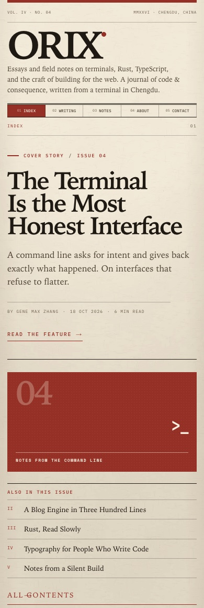
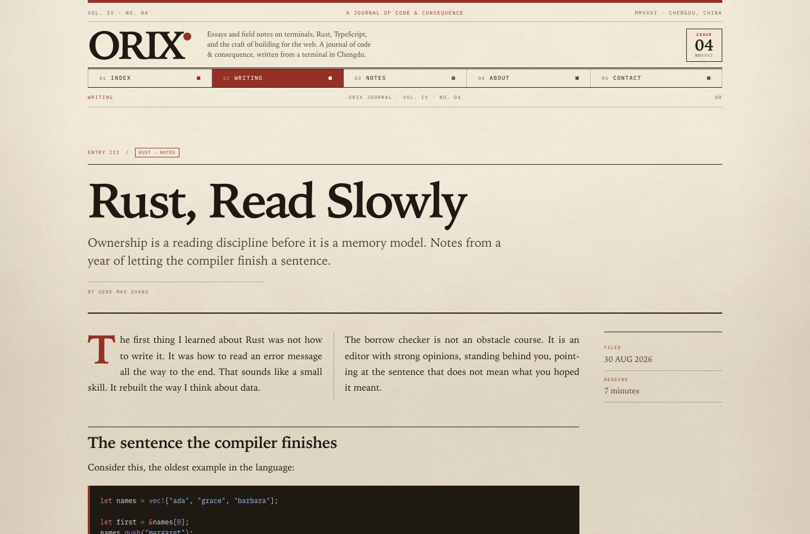

# Orix Journal

A retro magazine for Gene Max Zhang, set on warm newsprint with ink-black
serif headlines, red rules, and departments across the top. Essays and field
notes on terminals, Rust, TypeScript, and the craft of building for the web.

Built with Astro and plain CSS — no client-side framework, no theme switcher,
no analytics.


## The idea

The site reads like an independent print magazine rather than a feed. Every
page has a masthead, a running head, and a department number. The Index is a
cover story with an issue contents column; Writing is the contents page;
entries open into two-column features with marginalia. Notes, About, Contact,
and the 404 are separate editorial treatments rather than copies of one card.

Content is written in Markdown and published as static HTML.



## Running it

```sh
npm install
npm run dev        # http://localhost:4321
npm run build      # static output in ./dist
npm run preview    # preview the build
```

The dev server can also be managed in the background:

```sh
astro dev --background
astro dev status
astro dev logs
astro dev stop
```

## Structure

```text
src/
├─ components/
│  ├─ DepartmentNav.astro  # departments, numbers, active state
│  └─ SectionTitle.astro   # section headings with side notes
├─ content/
│  └─ writing/             # Markdown entries (one file per post)
├─ content.config.ts       # writing collection schema
├─ data/
│  ├─ site.ts              # identity, nav, dates, roman numerals
│  └─ notes.ts             # short field notes
├─ layouts/
│  └─ Layout.astro         # masthead, running head, issue, footer
├─ lib/
│  └─ posts.ts             # collection helpers
├─ pages/
│  ├─ index.astro          # cover story + issue contents
│  ├─ writing/index.astro  # contents page
│  ├─ writing/[slug].astro # two-column feature with marginalia
│  ├─ notes.astro          # field notes columns
│  ├─ about.astro          # author feature + skills/projects
│  ├─ contact.astro        # correspondence page
│  └─ 404.astro
└─ styles/
   └─ global.css           # newsprint, type, grid, departments, responsive
```

## Writing an entry

Add a Markdown file to `src/content/writing/`:

```md
---
title: "A Title"
date: 2026-10-18
summary: "One or two sentences for the contents page and meta tags."
tags: ["Essay", "Craft"]
minutes: 6
---

Body text. The first paragraph gets a drop cap in the entry layout.
```

The file name becomes the slug (`/writing/<file-name>`). Entries are sorted by
date, newest first; the home page uses the newest as the cover story and lists
the rest in the issue contents.

Notes are plain data in `src/data/notes.ts` — short, dated fragments rather than
full essays.

## Design notes

- **Type**: display and prose in a native editorial serif; labels, dates, and
  numbers in self-hosted IBM Plex Mono and Space Mono.
- **Paper**: a generated, seamless newsprint tile with a subtle fibre grain,
  warmed with a soft vignette. No flat background colour.
- **Cover**: a large serif cover line, a red halftone issue plate with a terminal
  cursor, an issue contents column, and a frontmatter spread with the author
  note and department index.
- **Departments**: a single row of numbered sections; the current department is
  a solid vermilion block. The same row becomes five equal cells on mobile.
- **Interior**: interior pages use a compact masthead. Writing is a contents
  page; entries are two-column features with a marginalia rail; Notes is a
  two-column log with a sidebar; About is a profile with a printed GMZ plate;
  Contact is a letter with a stamp block.
- **Rules**: black hairlines, double rules, dotted leaders, red accents, and
  tight editorial spacing do most of the layout work. There are no rounded
  cards.
- **Responsive**: the cover stacks, the article drops to one column, notes
  become a single column, and the footer stacks. The five departments remain
  visible at narrow widths.
- **Accessibility**: skip link, semantic landmarks, `aria-current` on the active
  department, visible focus rings, and reduced-motion support.

A feature spread:



The Contact page is a letter, not a form:


