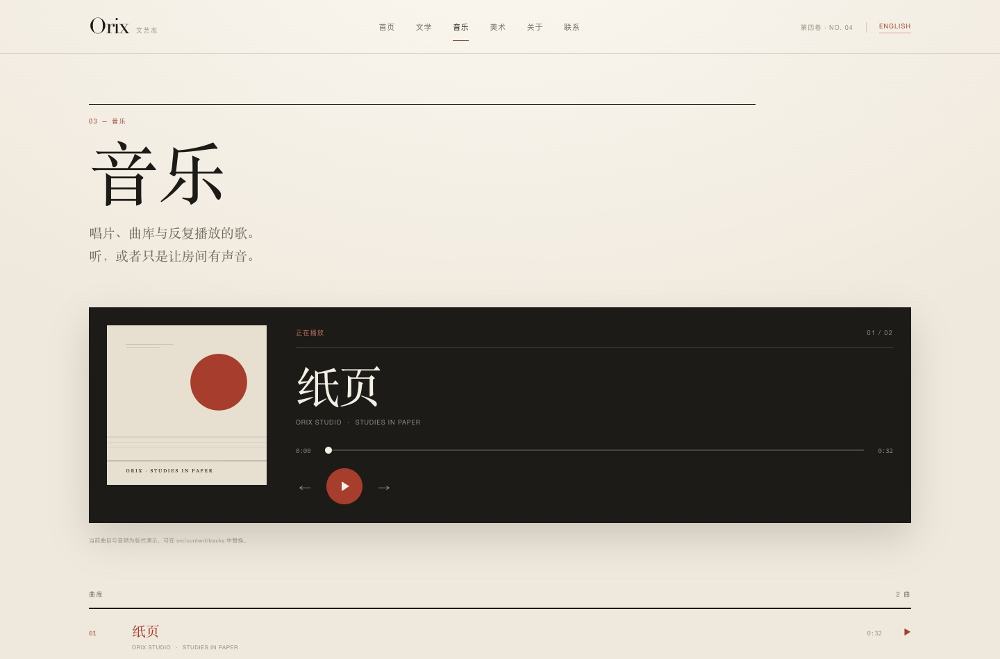
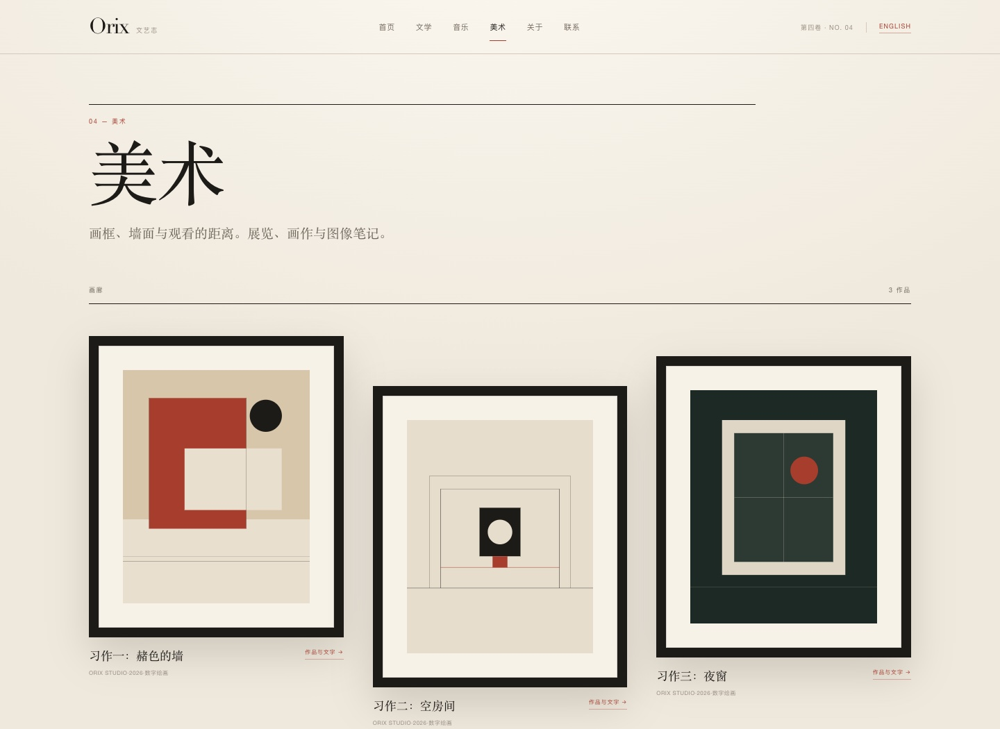
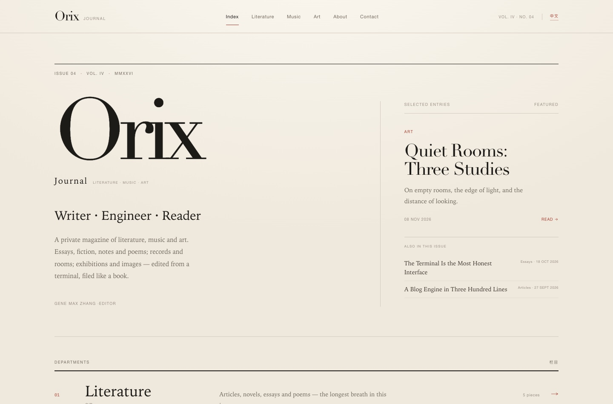

# Orix 文艺志

一个以**中文为主**的多语种个人文艺杂志：文学、音乐与美术。
纸色、墨色、单一朱红；大字号衬线标题、细规则线和大量留白。内容层是纯静态的，音乐有播放器和曲库，美术有画框、画廊和灯箱。

- 中文版：`/zh/`
- English edition：`/en/`
- 根路径 `/` 默认进入中文版


## 现在有什么

- **文学**：文章、小说（按系列/章节）、随笔、诗（保留换行）。
- **音乐**：可播放的曲库；上一首/下一首、播放/暂停、拖动进度、自动接下一首；曲目列表与封面。乐评仍然保留在 `music` 内容里。
- **美术**：带卡纸和画框的画廊墙；点击画框打开大图灯箱；作品详情页有多图展示和评论正文。
- **双语**：中文/英文独立版本、语言切换、`hreflang`、各自的 RSS/JSON Feed。
- **社区同步**：canonical、RSS/JSON、每篇内容的社区链接、`community.json`，以及知乎/微信公众号/B站/网易云音乐的导出包（dry run）。
- **静态站**：Astro 构建，纯 HTML/CSS/少量原生 JS，无前端框架。





## 内容怎么发

```text
src/content/
├─ writing/   # 文章、小说、随笔、诗
├─ music/     # 乐评
├─ tracks/    # 曲库（播放器读取）
└─ art/       # 作品、画框图片与评论
public/
├─ audio/     # 音频
├─ music/     # 专辑封面
└─ art/       # 画廊图片
```

文学用 `kind` 区分 `article | fiction | essay | poem`；小说一章一个文件，用 `series` + `order` 聚合；诗直接写在正文里，构建时按纯文本保留换行。

音乐曲目示例：

```yaml
---
title: "纸页"
date: 2026-11-02
lang: zh
artist: "Orix Studio"
album: "Studies in Paper"
duration: "0:32"
audio: "/audio/paper.m4a"
cover: "/music/paper-cover.svg"
order: 1
---
```

美术作品示例：

```yaml
---
title: "静室：三幅习作"
date: 2026-11-08
lang: zh
artist: "Orix Studio"
work: "静室"
medium: "数字绘画"
year: 2026
images:
  - src: "/art/study-ochre.svg"
    alt: "赭色与朱红构成的抽象习作"
    caption: "习作一：赭色的墙"
---
```

完整字段、连载、诗、乐评、美术、草稿和译文规则见 **[CONTENT.md](CONTENT.md)**。

## 演示内容

当前仓库带有可替换的演示素材，用来展示播放器和画廊：

- `src/content/tracks/`：2 首中文 + 1 首英文示例音轨（`public/audio/*.m4a`）
- `src/content/art/`：1 组中文 + 1 组英文示例画作（`public/art/*.svg`）
- `src/content/writing/first-issue-note.md`：中文卷首语
- 英语版保留原有 5 篇文章

替换或删除这些文件即可变成你自己的内容；播放器提示音轨是示例，曲库本身不需要改代码。

## 社区同步

构建后生成：

- `/zh/rss.xml`、`/en/rss.xml`
- `/zh/feed.json`、`/en/feed.json`
- `/zh/community.json`、`/en/community.json`

每篇内容支持：

```yaml
syndication:
  - platform: zhihu
    url: "https://zhuanlan.zhihu.com/p/xxxx"
    label: "知乎专栏"
```

```sh
npm run build
npm run sync:export
```

输出到 `community-export/`（已 gitignore）；这是导出/dry run，不会登录或调用第三方接口。平台限制与扩展说明见 **[SYNC.md](SYNC.md)**。

## 路由

```text
/                         -> /zh/
/zh/                      中文首页
/zh/literature            文学
/zh/literature/articles   文章
/zh/literature/fiction    小说与系列
/zh/literature/essays     随笔
/zh/literature/poetry     诗
/zh/literature/series/*   小说 / 诗集系列页
/zh/literature/*          单篇作品
/zh/music                 播放器 + 曲库
/zh/art                   画廊
/zh/art/*                 作品与文字
/zh/about, /zh/contact    关于 / 联系
/en/...                   英文版对应路由
```

## 运行

```sh
npm install
npm run dev          # 本地写作预览；草稿可见
npm run build        # 静态输出到 dist/
npm run preview      # 预览构建
npm run sync:export  # 构建后导出社区同步包
```

## 站点地址

`src/data/site.ts` 的 `url` 默认是占位地址 `https://orix.example`。部署前用环境变量覆盖：

```sh
ORIX_SITE_URL=https://your-domain.example npm run build
```

RSS、JSON Feed、canonical、hreflang 和社区导出都会使用这个地址。

## 结构

```text
src/
├─ components/
│  ├─ ArtLightbox.astro     # 画廊灯箱
│  ├─ GenreNav.astro
│  ├─ ReviewList.astro
│  ├─ SyndicationLinks.astro
│  ├─ Tabs.astro            # 顶部栏目
│  └─ WritingList.astro
├─ content/
│  ├─ writing/ music/ art/ tracks/
├─ data/site.ts
├─ i18n/ui.ts
├─ layouts/Layout.astro
├─ lib/posts.ts
├─ pages/[lang]/
│  ├─ literature/ music/ art/
│  ├─ rss.xml.ts feed.json.ts community.json.ts
│  └─ about.astro contact.astro
├─ styles/global.css
scripts/community-export.mjs
```

## 设计说明

- **纸面，不是拟物书壳**：暖纸底色、墨色正文、单一朱红；没有皮革、书脊、六色书签和卡片。保留卷号、版心、页码与书名页的编辑体例。
- **字体**：标题用 Didot/Palatino 一类的衬线，中文回退宋体/思源宋体；正文使用宋体阅读排版；小标签用极小的无衬线或等宽字。
- **音乐**：深墨色播放器作为整页唯一的重色块；封面、曲名、进度和曲库保持安静，不堆控件。
- **美术**：画框由卡纸、细框和轻微投影构成；画廊墙用不对称错位；灯箱只做放大与说明。
- **语言**：中文默认、英文独立；`<html lang>`、`hreflang`、canonical、语言切换和 RSS 都按语言生成。
- **无障碍**：skip link、语义化结构、`aria-current`、按钮 label、focus-visible、reduced-motion。





