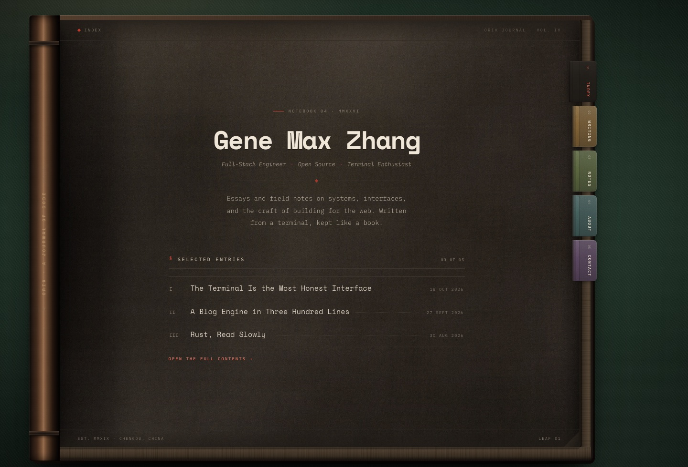
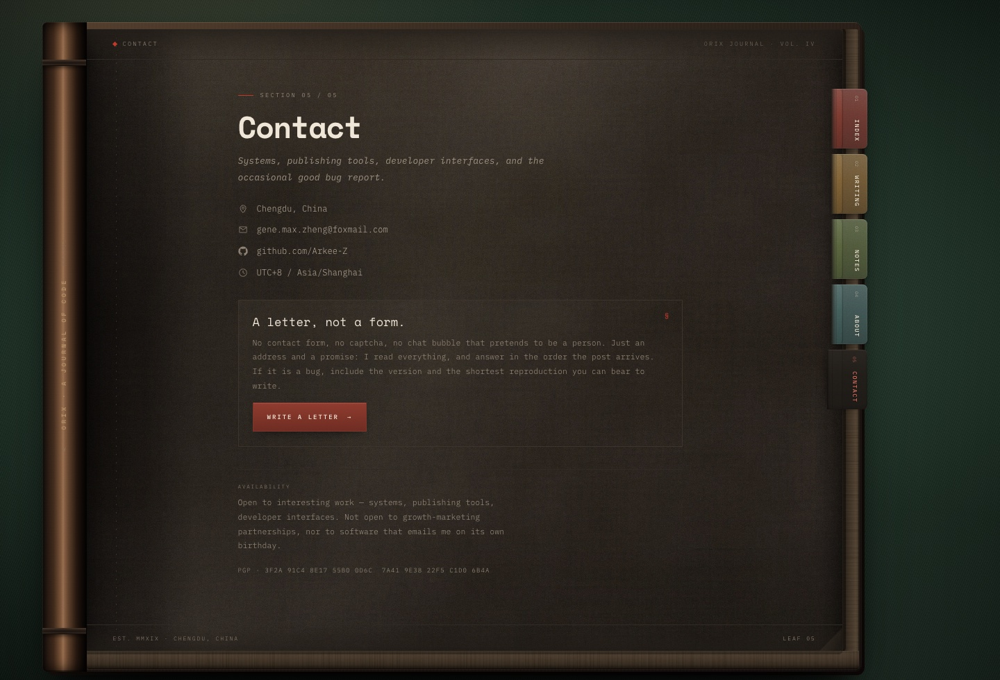

# Orix Journal

A small personal blog for Gene Max Zhang, set like a book on a dark green
baize desk. Warm paper, a blind-tooled cover, a stitched spine, and five paper
index tabs folded over the page's fore-edge. Built with Astro and plain CSS — no
client-side framework, no theme switcher, no analytics.

## The idea

Most blogs look like feeds. This one looks like a bound volume: a running head
at the top of the page, a folio at the bottom, a red seal for section marks, and
navigation rendered as vertical paper tabs pasted over the page's fore-edge, with
a crease where they fold around the paper. The page scrolls inside the cover, so
the tabs stay in your hand while you read.

Content is written in Markdown and published as static HTML.



## Running it

```sh
npm install
npm run dev        # http://localhost:4321
npm run build      # static output in ./dist
npm run preview    # preview the build
```

The dev server can also be managed in the background:

```sh
astro dev --background
astro dev status
astro dev logs
astro dev stop
```

## Structure

```text
src/
├─ components/
│  ├─ SectionTitle.astro   # § section headings with optional side note
│  └─ Tabs.astro           # paper index tabs pasted to the page edge
├─ content/
│  └─ writing/             # Markdown entries (one file per post)
├─ content.config.ts       # writing collection schema
├─ data/
│  ├─ site.ts              # identity, nav, date helpers, roman numerals
│  └─ notes.ts             # short field notes
├─ layouts/
│  └─ Layout.astro         # desk, book, spine, page, running head, folio
├─ lib/
│  └─ posts.ts             # collection helpers
├─ pages/
│  ├─ index.astro          # title page + selected entries
│  ├─ writing/index.astro  # table of contents
│  ├─ writing/[slug].astro # entry layout with marginalia
│  ├─ notes.astro          # field notes with marginalia
│  ├─ about.astro          # the only page spread: author / skills / projects
│  ├─ contact.astro        # single-column letter
│  └─ 404.astro
└─ styles/
   └─ global.css           # tokens, book shell, type, tabs, responsive
```

## Writing an entry

Add a Markdown file to `src/content/writing/`:

```md
---
title: "A Title"
date: 2026-10-18
summary: "One or two sentences for the index and meta tags."
tags: ["Essay", "Craft"]
minutes: 6
---

Body text. The first paragraph gets a drop cap in the entry layout.
```

The file name becomes the slug (`/writing/<file-name>`). Entries are sorted by
date, newest first; the home page lists the three most recent, the Writing tab
holds the full contents.

Notes are plain data in `src/data/notes.ts` — short, dated fragments rather than
full essays.

## Design notes

- **Type**: IBM Plex Mono for text, Space Mono for display. Both are self-hosted
  in `public/fonts/` (SIL Open Font License) and preloaded by the layout.
- **Palette**: warm near-black cover, dark brown paper, muted bone ink, vermilion
  seal marks, and five low-saturation tab colors.
- **Desk**: deep green baize built from layered CSS gradients and a fine woven
  grain, lit from the upper left and vignetted so the book stays the focus.
- **Paper**: a generated dark paper-fibre texture plus a fine fibre tile, a
  shadowed gutter curve, a worn corner, and a layered page block along the
  fore-edge.
- **Book details**: CSS gradients for the leather, a full-height rounded spine,
  a thin head square and a deeper tail square exposing the page block, stitched
  gutter, running head, folio, and vertical paper tabs folded over the fore-edge.
- **One layout per page**: a centred title page, a contents list, a
  marginalia-driven entry, a notes column, a single page spread (About), and a
  narrow correspondence letter. Nothing repeats unless it is book furniture
  (running head, folio, tabs).
- **Responsive**: below 1120px the spread becomes a single column; below 820px
  the tabs narrow further but stay folded over the page margin.
- **Accessibility**: skip link, semantic landmarks, focusable scroll region,
  `aria-current` on the active tab, visible focus rings, and reduced-motion
  support.

The Contact page gives up the spread entirely for a single letter:


