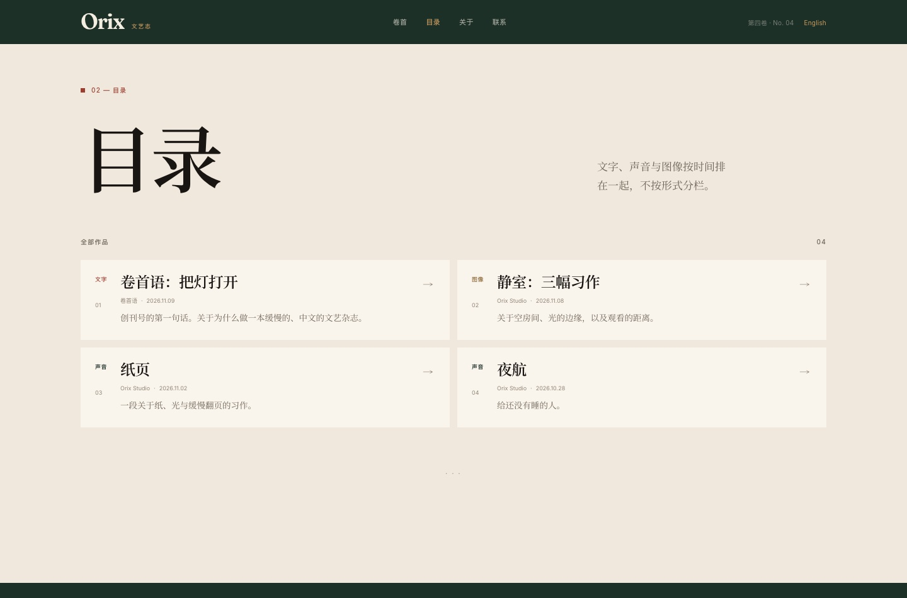

# Orix 文艺志

一个以**中文为主**的多语种个人文艺志。它不按“文学 / 音乐 / 美术”分栏，而是把文字、声音与图像按时间编进同一条目录。

顶部只有四个入口：**卷首 / 目录 / 关于 / 联系**。聆听室和画廊作为空间存在，从目录、作品与页脚进入，不再被做成硬性分类。


## 一条目录

- **文字**：文章、小说、随笔、诗。`kind` 只决定详情页如何排版（章节、诗行、正文），不再生成“文章 / 小说 / 随笔 / 诗”的分类栏目。
- **声音**：曲目、播放器、曲库；点击目录里的声音条目会进入聆听室并定位到该曲。
- **图像**：画框、画廊、灯箱；目录里的图像条目直接进入作品与文字。
- 目录是一个混合流：一首诗、一段录音、一幅画和一篇评论可以相邻出现，只用很小的“文字 / 声音 / 图像”标记提示媒介，不做分区。



## 聆听室与画廊

- **聆听室**：播放/暂停、上一首/下一首、进度拖动、自动接下一首；曲库与封面；不自动播放。
- **画廊**：卡纸、画框、错落的画廊墙；点击画框打开灯箱；作品详情页有多图展示与评论正文。


## 内容怎么发

```text
src/content/
├─ writing/   # 文字
├─ music/     # 关于声音的文字
├─ tracks/    # 曲库
└─ art/       # 图像与文字
public/
├─ audio/     # 音频
├─ music/     # 专辑封面
└─ art/       # 画廊图片
```

`kind: article | fiction | essay | poem` 仍保留，但它只是排版信息：小说可以有 `series`/`order`，诗会按纯文本保留换行。它不会在导航里生成分类。

音乐曲目示例：

```yaml
---
title: "纸页"
date: 2026-11-02
lang: zh
artist: "Orix Studio"
album: "Studies in Paper"
duration: "0:32"
audio: "/audio/paper.m4a"
cover: "/music/paper-cover.svg"
order: 1
---
```

美术作品示例：

```yaml
---
title: "静室：三幅习作"
date: 2026-11-08
lang: zh
artist: "Orix Studio"
work: "静室"
medium: "数字绘画"
year: 2026
images:
  - src: "/art/study-ochre.svg"
    alt: "赭色与朱红构成的抽象习作"
    caption: "习作一：赭色的墙"
---
```

完整字段、系列、诗、乐评、画廊、草稿和译文规则见 **[CONTENT.md](CONTENT.md)**。

## 视觉系统

这套主题是“当代文学评论刊物”，不是通用博客模板：

- 书眉/页脚/聆听室/重点面板：深松绿
- 纸面：骨白
- 强调：陶土红、赭金、鼠尾草
- 标题：Fraunces（拉丁）/ Noto Serif SC（中文）
- 界面：Inter
- 用色块、卡片、留白和深色面板建立层级；不使用页面分割线
- 画框是唯一的边框例外

完整的色板、字号、页面头、卡片、混合目录和新增内容类型的规则见 **[DESIGN.md](DESIGN.md)**。

## 演示内容

- `src/content/tracks/`：2 首中文 + 1 首英文示例音轨
- `src/content/art/`：1 组中文 + 1 组英文示例画作
- `src/content/writing/first-issue-note.md`：中文卷首语
- 英语版保留原有 5 篇文章

替换或删除这些文件即可；播放器和画廊不需要改代码。

## 路由

```text
/                         -> /zh/
/zh/                      卷首
/zh/index                 目录：文字、声音、图像混排
/zh/music                 聆听室（播放器 + 曲库）
/zh/art                   画廊
/zh/literature/<slug>     单篇文字（技术路径）
/zh/literature/series/*   小说 / 诗集系列
/zh/about, /zh/contact    关于 / 联系
/en/...                   英文版对应路由
```

## 运行

```sh
npm install
npm run dev          # 本地写作预览；草稿可见
npm run build        # 静态输出到 dist/
npm run preview      # 预览构建
npm run sync:export  # 构建后导出社区同步包
```

## 社区同步

构建后生成：

- `/zh/rss.xml`、`/en/rss.xml`
- `/zh/feed.json`、`/en/feed.json`
- `/zh/community.json`、`/en/community.json`

内容支持 `syndication` 链接；构建后可导出知乎/微信公众号/B站/网易云音乐包（dry run），不会调用第三方接口。详见 **[SYNC.md](SYNC.md)**。

## 站点地址

`src/data/site.ts` 的 `url` 默认是 `https://orix.example`。部署前用环境变量覆盖：

```sh
ORIX_SITE_URL=https://your-domain.example npm run build
```

RSS、JSON Feed、canonical、hreflang 和社区导出都会使用它。

## 结构

```text
src/
├─ components/
│  ├─ IndexList.astro       # 混合目录
│  ├─ ArtLightbox.astro
│  ├─ ReviewList.astro
│  ├─ SyndicationLinks.astro
│  └─ Tabs.astro            # 卷首/目录/关于/联系
├─ content/ writing/ music/ art/ tracks/
├─ i18n/ui.ts
├─ layouts/Layout.astro
├─ lib/posts.ts
├─ pages/[lang]/
│  ├─ index/index.astro     # 混合目录
│  ├─ literature/           # 单篇与系列
│  ├─ music/ art/           # 聆听室 / 画廊
│  ├─ about.astro contact.astro
│  └─ rss.xml.ts feed.json.ts community.json.ts
├─ styles/global.css
public/
├─ fonts/                   # Noto Serif SC（自托管）
├─ audio/ music/ art/
scripts/community-export.mjs
```

## 字体

- Fraunces、Inter 通过 `@fontsource-variable` 本地打包。
- 中文 Noto Serif SC 以 WOFF2 自托管在 `public/fonts/`，不依赖 Google Fonts。
- 授权文件在 `public/fonts/licenses/` 与 `public/fonts/noto-serif-sc-OFL.txt`。


